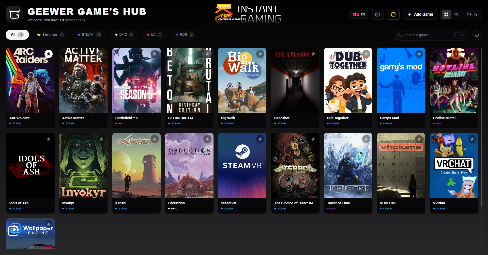
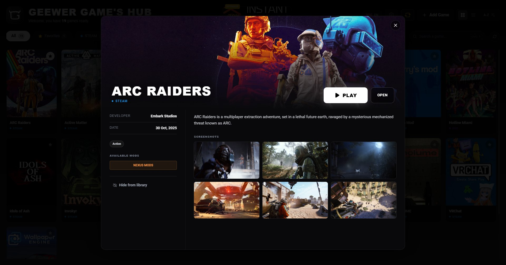

<div align="center">


# Geewer's Game Hub

**Tous tes jeux PC. Une seule bibliothèque.**<br>
*All your PC games. One library.*

[](https://apps.microsoft.com/detail/9N9CF4NLLQZ7?hl=fr&gl=FR&ocid=pdpshare)


**[🇫🇷 Français](#-français)** · **[🇬🇧 English](#-english)**



</div>

---

## 🇫🇷 Français

Marre de jongler entre Steam, Epic, GOG, Ubisoft Connect et l'EA app juste pour retrouver un jeu ?
**Geewer's Game Hub** scanne ton PC, trouve tous tes jeux installés, peu importe la boutique, et les réunit dans une seule interface, belle et rapide.

Léger, codé en **Rust avec Tauri**, il ne tourne pas en arrière-plan pour rien.

### ✨ Fonctionnalités

| | |
|---|---|
| 🎮 **Détection automatique** | Steam, Epic Games, GOG, Ubisoft Connect et EA app. Les outils et redistribuables sont ignorés |
| 🖼️ **Visuels HD** | Jaquettes 1200×1800, bannières 4K et captures d'écran, même pour tes jeux hors Steam |
| 🔎 **Recherche instantanée** | `Ctrl+F`, insensible aux accents |
| ⏱️ **Reprendre** | Tes derniers jeux lancés en haut de la bibliothèque, tri par jeux récents |
| ⭐ **Organisation** | Favoris, jeux masqués, ajout manuel de n'importe quel `.exe` (indés, émulateurs…) |
| 📖 **Fiche de jeu** | Développeur, date de sortie, Metacritic, genres, durée de vie (HowLongToBeat) et mods dispo sur Nexus Mods / Thunderstore |
| 🎨 **Thèmes** | 8 thèmes prêts à l'emploi ou tes propres couleurs |
| ⚙️ **Pratique** | Choix des disques à scanner, démarrage avec Windows, rescan avec `F5`, interface FR / EN |

<div align="center">

</div>

### 📥 Installation

Le plus simple : **[télécharge-le sur le Microsoft Store](https://apps.microsoft.com/detail/9N9CF4NLLQZ7?hl=fr&gl=FR&ocid=pdpshare)**.

### 🛠️ Compiler depuis les sources

Prérequis : [Node.js](https://nodejs.org) et [Rust](https://rustup.rs).

```bash
git clone https://github.com/BateMane/geewergameshub.git
cd geewergameshub
npm install
npm run tauri dev      # lancer en mode développement
npm run tauri build    # générer l'installateur .msi
```

L'installateur est généré dans `src-tauri/target/release/bundle/msi`.
Pour le package Microsoft Store, lance ensuite `powershell -File scripts/build-msix.ps1` (nécessite le Windows SDK).

### 🧱 Stack technique

- **Interface** : SvelteKit + Tailwind CSS
- **Backend** : Rust via Tauri 2 (scan des bibliothèques, lancement des jeux, sauvegarde locale)
- **Données** : API Steam (visuels, fiches), Thunderstore, Nexus Mods, HowLongToBeat

### 💬 Contribuer

Une idée, un bug ? Ouvre une [issue](https://github.com/BateMane/geewergameshub/issues) ou utilise le bouton de feedback dans les paramètres de l'app.
Si l'app te plaît, une note sur le Store ou un [café](https://buymeacoffee.com/geewerrr) fait toujours plaisir ☕

---

## 🇬🇧 English

Tired of juggling Steam, Epic, GOG, Ubisoft Connect and the EA app just to find a game?
**Geewer's Game Hub** scans your PC, finds every installed game whatever the store, and brings them together in one fast, beautiful interface.

Lightweight and built with **Rust and Tauri**, it doesn't sit in the background for nothing.

### ✨ Features

| | |
|---|---|
| 🎮 **Automatic detection** | Steam, Epic Games, GOG, Ubisoft Connect and EA app. Tools and redistributables are skipped |
| 🖼️ **HD artwork** | 1200×1800 covers, 4K banners and screenshots, even for non-Steam games |
| 🔎 **Instant search** | `Ctrl+F`, accent-insensitive |
| ⏱️ **Jump back in** | Your last played games at the top of the library, sort by recent |
| ⭐ **Organization** | Favorites, hidden games, add any `.exe` manually (indies, emulators…) |
| 📖 **Game page** | Developer, release date, Metacritic, genres, time to beat (HowLongToBeat) and available mods on Nexus Mods / Thunderstore |
| 🎨 **Themes** | 8 ready-made themes or your own colors |
| ⚙️ **Handy** | Choose which drives to scan, start with Windows, rescan with `F5`, FR / EN interface |

### 📥 Install

The easiest way: **[get it on the Microsoft Store](https://apps.microsoft.com/detail/9N9CF4NLLQZ7?hl=fr&gl=FR&ocid=pdpshare)**.

### 🛠️ Build from source

Requirements: [Node.js](https://nodejs.org) and [Rust](https://rustup.rs).

```bash
git clone https://github.com/BateMane/geewergameshub.git
cd geewergameshub
npm install
npm run tauri dev      # run in development mode
npm run tauri build    # build the .msi installer
```

The installer is written to `src-tauri/target/release/bundle/msi`.
For the Microsoft Store package, then run `powershell -File scripts/build-msix.ps1` (requires the Windows SDK).

### 🧱 Tech stack

- **Frontend**: SvelteKit + Tailwind CSS
- **Backend**: Rust via Tauri 2 (library scanning, game launching, local storage)
- **Data**: Steam API (artwork, game pages), Thunderstore, Nexus Mods, HowLongToBeat

### 💬 Contributing

Got an idea or found a bug? Open an [issue](https://github.com/BateMane/geewergameshub/issues) or use the feedback button in the app settings.
If you like the app, a Store rating or a [coffee](https://buymeacoffee.com/geewerrr) is always appreciated ☕

---

<div align="center">
<sub>Made with ❤️ by <b>geewerrr</b></sub>
</div>
